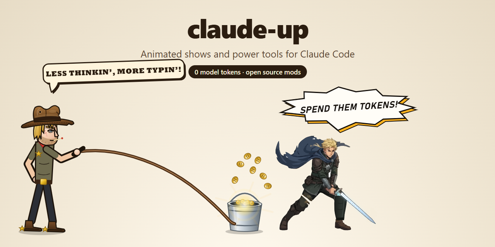

# damn-ddd: a show behind the chat while Claude works



When one reply runs long, an animated show plays behind the chat in the Claude Code desktop app:

- **damn1:** a cowboy cracks his whip at a bucket of tokens and shouts lines like "Round up them tokens!".
- **damn2:** an anime hero lifts his sword and cuts an evil winged token in two, shouting one of "Spend them tokens!", "Rate limit comin'!" or "Every token counts!".

Long replies take turns: damn1, then damn2, then damn1 again, remembered across sessions. Each show speeds up the longer the reply runs, and stays until you click.

## Install

At the prompt of a terminal session:

```
/plugin install damn-ddd --marketplace danielsddd/claude-up
```

Then `y` to add the marketplace and pick the user scope. Or run it from a clone of this repo; see the [main README](../../README.md#quickstart-about-a-minute).

## Use it

| To | Do |
| --- | --- |
| Get a show automatically | Nothing: it starts when one reply has run 10 minutes, speeds up at 15 and 20 |
| Start one now | `/damn1` or `/damn2` |
| Send it off | Click an empty part of the window, or right-click → **Send him off**, or `/damn1 stop` |
| Change the wait | Settings → the mod's **Show starts after (seconds)** option (5 to 3600, default 600) |

The shows draw in the desktop and mobile apps. A terminal has no backdrop, so there the mod does nothing.

## Token cost

**Zero model tokens.** The mod never calls a model and never adds text to your prompt or system prompt. Every hook passes its event through unchanged; it only draws the backdrop, keeps a timer and plays a short crack sound. The command replies are display-only, so they never reach the model. The one trace a typed `/damn1` leaves is Claude Code's own one-line record of the command in your conversation, a few dozen tokens. The automatic show, a click and the right-click menu add nothing.

## How it works

- **The backdrop.** The mod sets a theme with a `backdrop` scene at session start, and a `ui.render` hook on `Backdrop` answers with an `Svg`. The app draws it full window, behind the conversation.
- **The size limit.** A backdrop is one `Svg` of at most 131,072 characters, pure vector: no images, no fonts, no `<image>`. So every frame of a show has to fit in 128 KB of SVG text.
- **damn1** is hand-written SVG and CSS (`hooks/scene.ts`): the cowboy, a whip animated with SMIL, and a speech balloon cycling through lines. Three stages, each a little wilder.
- **damn2** is played like hand-drawn anime, as held key frames (`hooks/scene2.ts`): stand, lift, swing, strike. A timer in `hooks/register.tsx` swaps frames (1.3 s, 0.65 s, 0.12 s, 1.8 s, faster at each stage), and each frame moves on its own with CSS: wings flap, the slash sweeps, the token splits and falls, the balloon pops.
- **The art.** The hero and token are traced from hand-drawn character art into vector paths (`hooks/art2.ts`, generated). The swords are clean vector shapes drawn by code, which leaves the size budget for the hero's face and the token's teeth. See [tools/](tools) for the tracing pipeline and the source images.
- **The balloons** (`hooks/balloon.ts`) are single closed paths with the tail built in, so the outline never crosses itself: a western comic balloon for damn1 and a jagged manga shout for damn2.
- **Timing.** On `turn.start` (main turns only, never subagents) a timer waits for the threshold; if the reply is still running, the next show comes out, and a light 5 s tick raises the stage at 1.5x and 2x the wait. A click (`ui.pointer`) or the right-click row ends it at once.

## Lessons from building it

These cost hours to find. The code has comments and tests guarding each one.

1. **Always answer the backdrop with a drawing.** With no show out, the mod first answered `next(e)` ("nothing"). The desktop app kept that first answer and ignored every later redraw, so no show ever appeared. Now it answers an empty, see-through `Svg` when idle.
2. **Ask for redraws yourself.** The app doesn't redraw the backdrop when the mod's state changes, so every change calls `$.ui.invalidate('ui.render')`.
3. **No `isInteractive` on the backdrop.** It turns the drawing into a sandboxed frame that swallows clicks, so `ui.pointer` never fires and a click can't send the show off. A plain image still plays its CSS animation.
4. **Match by scene, not plugin id.** Loaded from a folder, the plugin's id can read `damn-ddd@inline`.
5. **`glass: false`** keeps the show sharp where the chat column sits over it; the default glass frosts it.
6. **Never load two copies.** A dev copy plus an installed copy both answer commands and fight over the backdrop.

## Make it yours

- **Lines:** damn1's are the `says` lists in `LOOKS` in `hooks/scene.ts` (three per stage), damn2's in `LINES` in `hooks/scene2.ts`.
- **Timing:** `BEAT_MS` and `TEMPO` in `hooks/register.tsx`.
- **Placement:** `LEFT_FEET_PX` and `GROUND_PX` in `hooks/scene.ts` (both shows stand there).
- **Your own character:** put your images in `tools/source-art/` and follow [tools/README.md](tools/README.md).

Check a change with `claude plugin validate .` and `claude plugin test .` from this folder. The tests run the real engine with a fake clock: a fast reply shows nothing, a slow one brings a show at 10 minutes, the shows take turns, every frame fits the cap, and the backdrop never answers "nothing".

## Files

| File | What it is |
| --- | --- |
| `hooks/register.tsx` | Timers, commands, click handling, the backdrop and right-click hooks |
| `hooks/scene.ts` | damn1: the cowboy scenes, one per stage |
| `hooks/scene2.ts` | damn2: the six frames (stand, lift, swing, three strikes) |
| `hooks/balloon.ts` | The two speech balloon shapes |
| `hooks/art2.ts` | Generated vector art for damn2 (don't edit by hand) |
| `assets/crack.wav` | The whip crack, synthesized in code |
| `types/index.d.ts` | The mod's state contract |
| `tests/` | Engine tests |
| `tools/` | The tracing pipeline and source art |
